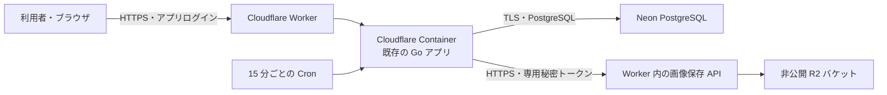

# Cloudflare + Neon 実務テスト環境

この設定は既存 Docker 環境と切り離した検証用です。既存の Dockerfile / docker-compose とローカルデータは維持し、同じ Go アプリ・フロントエンドを Cloudflare Containers で実行します。取引データは Neon PostgreSQL、画像は非公開 R2 に保存します。



## 既存動作を維持する範囲

- 既存ルーティング、ログイン、権限、商品、取引、伝票、PDF / CSV / タグは同じアプリバイナリで提供します。
- 変更は実行設定、Neon 接続とマイグレーションの分離、R2 保存アダプターです。通常の Docker の既定設定は変えません。
- 画像 API は秘密トークン付きのサーバー間通信だけを許可します。R2 の公開 URL は有効にしません。
- コンテナのディスクは永続保存先にしません。`/tmp/zaiko-compat.db` は互換用の一時領域であり、PostgreSQL モードの業務データは Neon が保存します。
- 1 個の固定コンテナへ振り分けます。定期ヘルスチェックで起動を維持するため、既存の 30 分ごとの SMBC 同期処理が動作します。Cron を止めると自動取得の時刻を保証できません。24 時間稼働に応じて課金されます。

## 必要なサービス

1. Containers を利用可能な Cloudflare Workers のアカウント。
2. Neon の検証用プロジェクト / ブランチ。既存業務 DB の接続先を使い回さないこと。
3. Cloudflare R2 の非公開バケット `qurioucity-zaiko-test-images`。
4. コンテナを扱える Wrangler OAuth 権限。`wrangler whoami` で確認し、`containers:write` / `cloudchamber:write` 等の不足時は `wrangler login` で更新します。

Neon は `sslmode=require` 以上の TLS 接続を使用します。通常実行には pooled URL、スキーマ更新には direct URL を分けます。DB の初期化は対象 DB に対して加算的に行われるため、稼働中の DB を誤指定しないでください。バックアップ・復元保持期間は Neon の契約プランで別途設定します。

## ビルドと確認

PowerShell、Node.js 24、Go（go.mod 指定版）、pnpm、Docker Engine が必要です。リポジトリのルートで実行します。

```powershell
pnpm --dir deploy/cloudflare install --frozen-lockfile
pnpm --dir deploy/cloudflare run check
pnpm --dir deploy/cloudflare test
./deploy/cloudflare/build.ps1
pnpm --dir deploy/cloudflare exec wrangler deploy --dry-run
```

`build.ps1` はフロントエンドをビルドし、既存 Dockerfile と同じ `CGO_ENABLED=0` / Linux amd64 の Go バイナリを生成します。クラウド専用 Dockerfile は、既存 Docker と同じ distroless / nonroot ランタイムにそのバイナリを配置します。バイナリと秘密情報は Git に含めません。フロントエンドを直前にビルド済みの場合だけ `-SkipFrontend` を使用できます。

`--dry-run` でも Docker イメージのビルドは実行されますが、アカウントへのデプロイは行いません。

## 環境ごとの設定

`deploy/cloudflare/wrangler.jsonc` で以下を設定します。

| 設定 | 内容 |
|---|---|
| `account_id` | デプロイ先 Cloudflare アカウント |
| `name` | Worker 名 |
| `r2_buckets[].bucket_name` | 専用の非公開画像保存先 |
| `vars.PUBLIC_BASE_URL` | Worker の実際の HTTPS URL。仮の `REPLACE` は必ず変更 |
| `vars.APP_INSTANCE_NAME` | コンテナの識別名。DB接続先や接続認証情報の切替時は新しい名前に変更して、新設定での起動と業務データを確認する |
| `vars.APP_REVISION` | 更新ごとに変更する識別子。build.ps1 がビルド成功後に更新。Secret だけを変更した場合も更新して再デプロイする |
| `vars.ORGANIZATION_CODE` | この環境の組織コード。データ移行時は移行元と整合させる |

以下は必ず `wrangler secret put` 等で登録し、設定ファイルへ直書きしません。

| Worker secret | コンテナへの用途 |
|---|---|
| `DATABASE_URL` | `ZAIKO_DATABASE_URL`: Neon pooled 接続 |
| `DATABASE_MIGRATION_URL` | `ZAIKO_DATABASE_MIGRATION_URL`: Neon direct 接続 |
| `R2_GATEWAY_TOKEN` | `ZAIKO_R2_GATEWAY_TOKEN`: 32 文字以上のランダム値 |
| `ADMIN_PASSWORD` | 初期管理者用の強固な 16 文字以上のパスワード |
| `WORKER_PASSWORD` | 初期担当者用の別の強固な 16 文字以上のパスワード |

これらの環境変数だけでは、本番モードにユーザーやテスト商品は作成されません。空の DB には後述の bootstrap-clean で初期管理者を作成します。既存ユーザーのパスワードを自動変更するものではありません。アプリは `ZAIKO_PUBLIC_DEMO_LOGIN=false`、HTTPS、Secure Cookie で起動します。

```powershell
pnpm --dir deploy/cloudflare exec wrangler r2 bucket create qurioucity-zaiko-test-images
pnpm --dir deploy/cloudflare exec wrangler secret put DATABASE_URL
pnpm --dir deploy/cloudflare exec wrangler secret put DATABASE_MIGRATION_URL
pnpm --dir deploy/cloudflare exec wrangler secret put R2_GATEWAY_TOKEN
pnpm --dir deploy/cloudflare exec wrangler secret put ADMIN_PASSWORD
pnpm --dir deploy/cloudflare exec wrangler secret put WORKER_PASSWORD
pnpm --dir deploy/cloudflare exec wrangler deploy
pnpm --dir deploy/cloudflare exec wrangler containers list
```

Cloudflare 初回起動は数分かかることがあります。起動待ちは 503 + Retry-After で返し、取引を更新する HTTP リクエストを自動再送しません。Worker 自体は外部へ機密情報や接続文字列を返しません。

## 空の検証 DB の初期化

`ZAIKO_DATABASE_DRIVER=postgres`、`ZAIKO_DATABASE_URL`、`ZAIKO_DATABASE_MIGRATION_URL`、`ZAIKO_ENV=production`、`ZAIKO_COOKIE_SECURE=true`、`ZAIKO_PUBLIC_BASE_URL`、`ZAIKO_ORGANIZATION_CODE=CLEAN` を保護されたローカル環境から渡し、次の順で実行します。接続文字列やパスワードはコマンド引数へ書きません。

```powershell
go run ./cmd/migrate
go run ./cmd/bootstrap-clean --password-file <保護された初期管理者パスワードファイル> --username admin
go run ./cmd/bootstrap-clean --audit
```

`bootstrap-clean` は既にデータがある DB には変更を行わず終了します。業務データや従来のテストデータを自動移行しません。運用者アカウントは管理者ログイン後に必要な権限で追加してください。

更新番号が変わった最初のアクセス時は、既存コンテナへ SIGTERM を送り終了を待ってから新しい設定で起動します。15 秒で終了しない場合はそのコンテナだけを停止します。Neon・R2・Durable Object の保存内容は消しません。入口の更新処理は自動再送しないため、起票中の更新は避けて実施してください。

## 今回の初回デプロイ確認

- 専用 URL: https://qurioucity-zaiko-test.qurioucitywork.workers.dev
- Worker version: `479df2b8-eae7-493c-830a-8244def56e3e`
- `/healthz`: 200、`/app/admin-reference/index.html`: 200
- 未認証 `/api/v1/products`: 401、未認証 `/__storage/probe.jpg`: 404
- TypeScript 検査、R2 ゲートウェイの 5 テスト成功。

上記は初回接続と基本アクセス制御の確認結果です。全業務テストの完了を意味するものではありません。

## 運用テストと移行判定

- HTTPS / ログイン必須、管理者・担当者・ゲストの権限、再起動後のセッションを確認。
- 商品登録から仕入・出荷・売上・返品・原価調整までを通し、手数料と `99999` の調整行も確認。
- 全伝票の PDF / CSV、海外向け CSV、タグ、為替換算と SMBC 1% 変動通知を確認。
- 画像をアップロードし、コンテナを再起動した後も元画像のバイト列を取得できることを確認。
- 2 人以上の同時操作、重複起票防止、Neon 復帰時の遅延、画像量を含む速度を確認。
- Neon の復元を別ブランチで実際に行い、画像の別保管 / 復元とデータ照合も実施。

Cloudflare のデプロイ完了だけでは、これら全業務の同等性確認が完了したことにはなりません。元環境の削除・切替は検証後に行います。初回は空の検証用 DB に起動し、データを移す場合は専用バックアップから件数・金額・画像を照合して移行します。

## アクセス制限を追加する場合

Cloudflare Access の社員向け制限、MFA、社内固定 IP / VPN 回線、ゲスト用ルールは本番のアクセス方針が決まってから別途設定します。現在の入口はアプリログインが必須です。Access を導入するときは、サーバー間の `/__storage/*` への通信を Access で誤って遮断しないよう専用ポリシーを設計します。この経路は Access の有無にかかわらず R2 専用秘密トークンを検証し続けます。

秘密トークンの更新時は Worker とコンテナを同時に更新・再起動します。古い環境と新しい環境で DB や画像バケットを共用すると業務テストが本番へ影響するため、必ず分離します。

## 公式資料

- Cloudflare Containers: https://developers.cloudflare.com/containers/get-started/
- Durable Object Container API: https://developers.cloudflare.com/containers/api/durable-object-container/
- R2 Workers API: https://developers.cloudflare.com/r2/api/workers/workers-api-reference/
- Neon connection pooling: https://neon.com/docs/connect/connection-pooling

2026-11-24 時点の Wrangler 4.166.0 / Workers 型 5.20261121.1 に固定し、TypeScript 検査と R2 ゲートウェイの認証・往復・入力制限テストを含めています。


## 登録済みデータの移行（2026-11-24）

初回の空 DB とは別に `zaiko_restored_20261124` を作成し、移行元と全80テーブルの件数・内容の照合後に切り替えました。組織・商品・伝票・画像の ID は維持しています。認証情報はクラウド専用のものを使用し、従来のログインセッションは引き継ぎません。

商品画像16件と保存済みPDF12件、計28件（12,466,417バイト）を元の object_key のまま非公開R2へ保存しました。全件を再取得し、SHA-256・サイズ・Content-Typeを照合しました。移行用スクリプト `scripts/cloud-migrate-images.ps1` は既定でローカル検証だけを行い、`-Apply` 指定時だけ保存します。同名で異なる内容が存在する場合は上書きせず停止します。

今回、同一コンテナ識別名の更新だけではDB接続先の切替を業務画面で確認できなかったため、`APP_INSTANCE_NAME=zaiko-restored-20261124` に変更して新しいコンテナで起動しました。公開画面で「株式会社ポレポレ」と元のマスタ・取引件数が確認できてから切替を確定しています。今後もDB接続先・接続認証情報を変更するときは、更新番号だけでなくコンテナ識別名を変更し、ヘルスチェックに加えてログイン後の組織IDと業務件数を確認してください。

元の `neondb` とローカルの元データは保持しています。旧コンテナは公開入口・Cronの接続先から外れ、無通信タイムアウトで停止する構成です。ロールバック用の接続設定はローカルの Git 対象外領域に退避し、秘密情報・DBバックアップ・画像は GitHub に含めません。

切替後の Worker バージョン: `a658d714-a366-4332-a043-74b76f3c6879`。コンテナのアプリイメージは初回デプロイと同じものです。
